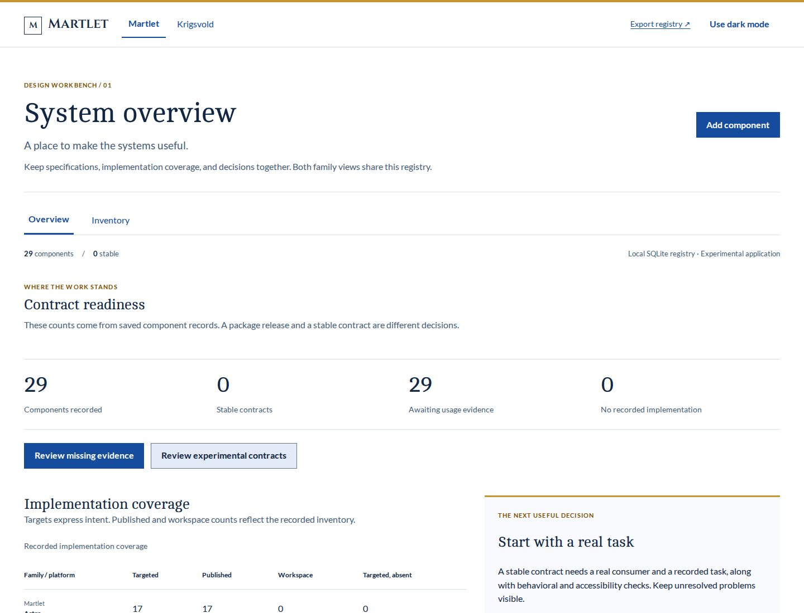
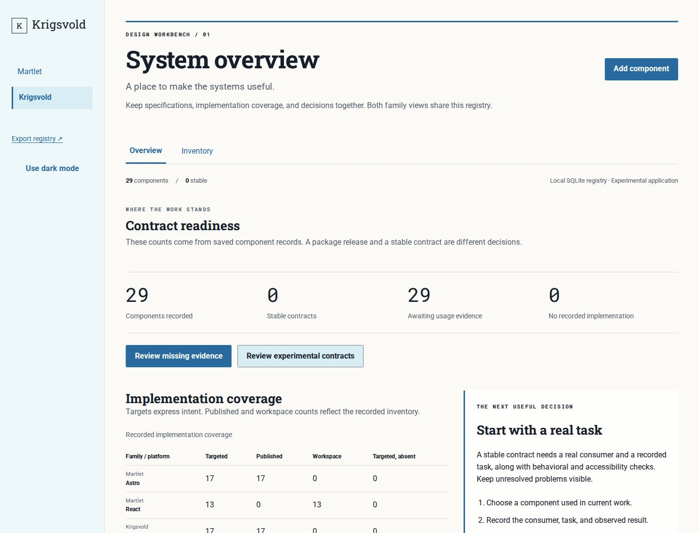
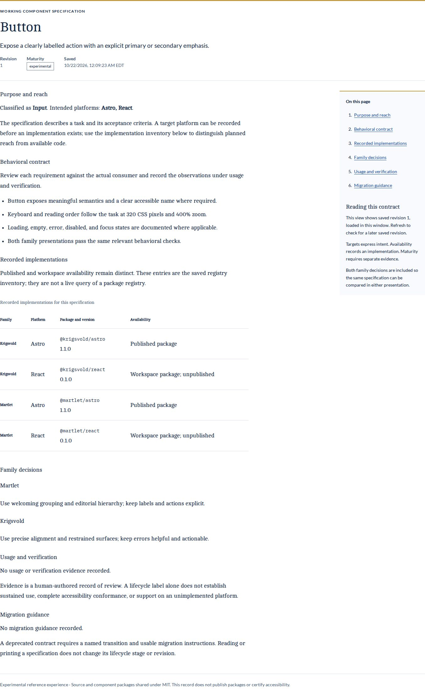
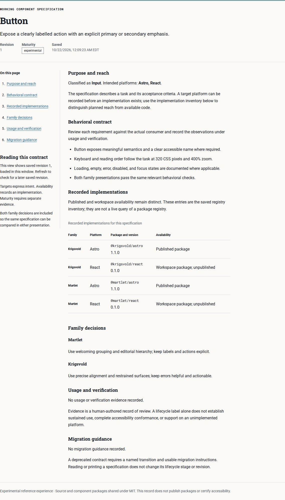
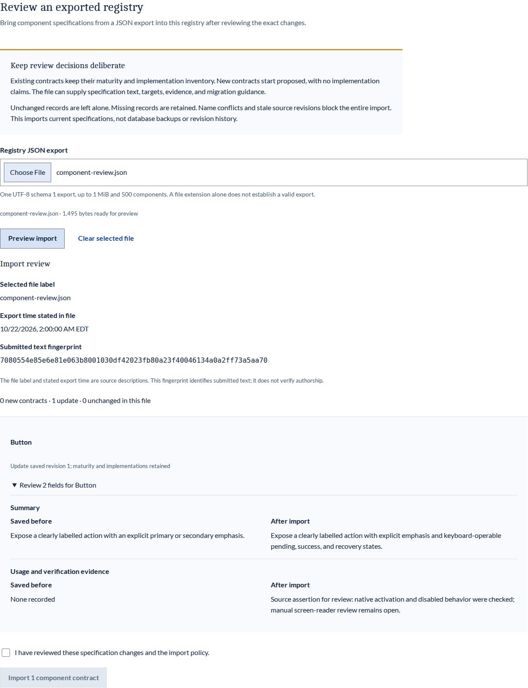
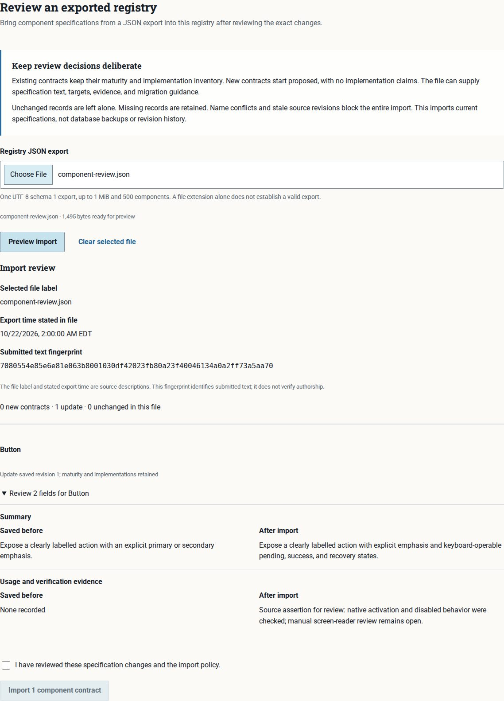
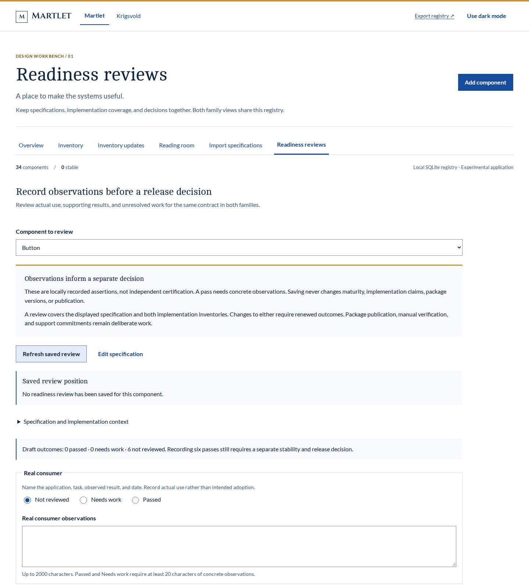
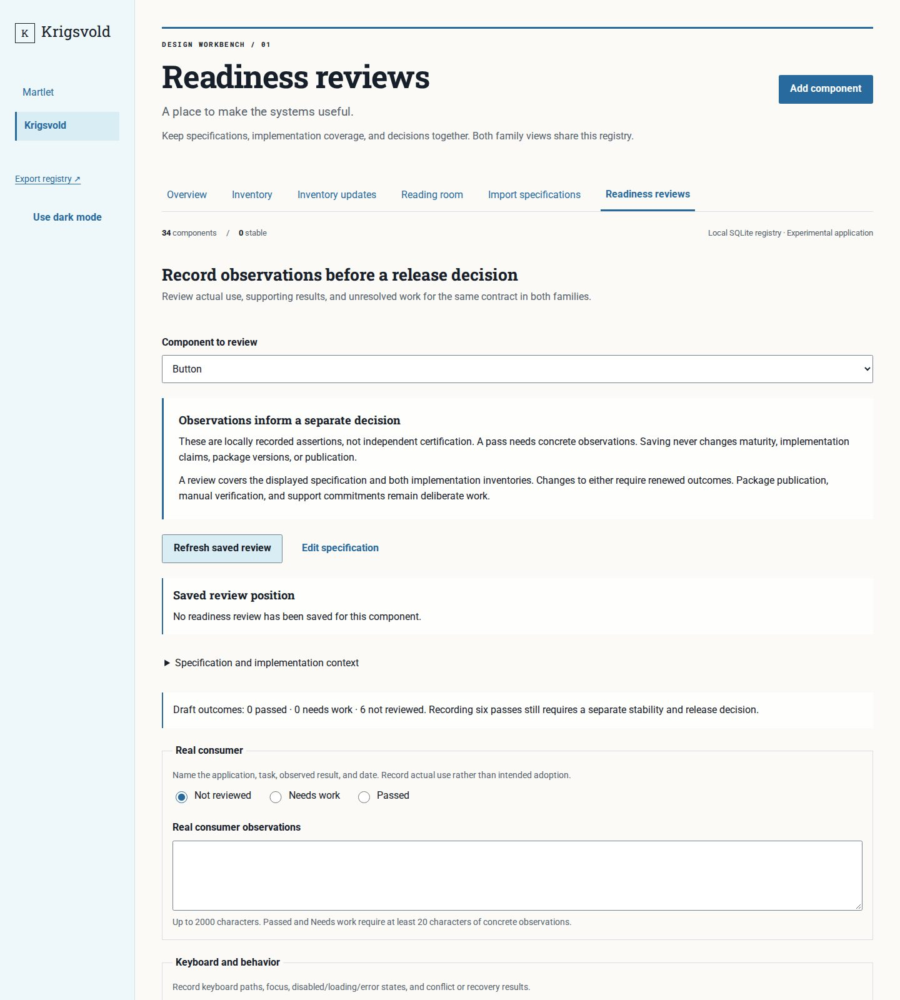

# Design workbench

Martlet and Krigsvold have separate experimental language references, existing theme-site marks, proposed application grammars, and working collection/editor patterns. Each includes a local MCP server with 52 attributed references and a companion builder skill. **Origin fidelity is under review; neither grammar is locked.** The [October 23 origin audit](docs/qa/origin-audit-2026-10-23.md) records source differences and recommended dispositions, including palette-role, navigation, TOC, typography, spacing and interaction findings. Read the [demonstration walkthrough](docs/demo-walkthrough.md), [language brief](docs/ui-grammars.md), [reference apps](docs/react-sites.md), and [agent setup](docs/mcp.md). All remain MIT and experimental; the first task pattern is session-only, and the React packages are not published to npm.

A working component registry for **Martlet** and **Krigsvold**, with independent React presentations and one shared data contract. Use it to manage component requirements, target platforms, family decisions, maturity, and usage evidence. MIT licensed, including the application, specifications, and both component packages.

## Run it

Use Node 24.19 or a later Node 24 release and npm 11.

```sh
npm ci --ignore-scripts
npm run build
npm start
```

Open **http://127.0.0.1:4173/martlet/** or **http://127.0.0.1:4173/krigsvold/**. Both views edit the same database. The default database is `var/registry.sqlite`; set `REGISTRY_DB` to choose another path and `PORT` to choose another loopback port. For development, build once, then run `npm run dev` and reload after changes. Dev mode deliberately disables HMR. Node's bundled SQLite may print an experimental-feature warning on the supported Node version.

Read and print full saved specifications in the reading room, including both families’ decisions; review coverage and missing evidence in the overview; search, sort, or paginate the inventory; inspect a component, edit its specification, save, and reload. Record six structured readiness observations, review gaps, and renewed outcomes after specification changes. Saving observations does not promote maturity or publish packages. Add components as work expands. Failed writes preserve drafts, stale revisions produce an explicit conflict, and unsaved navigation offers a choice. The initial 38 records reflect the exported Astro and React component inventory, with published Astro implementations distinguished from unpublished React workspace implementations. All seed maturity stages remain experimental and evidence starts empty. Seed records are installed once when the database is created; restarting never replaces edits.

## Boundaries of this first release

This is an **experimental, single-user local application**. It binds only to 127.0.0.1, rejects unexpected Host/Origin requests, and has no account or authentication model. It is usable for actual registry work now. Public or team hosting requires authentication, authorization, operational backups, persistent storage, and a deployment review. Do not expose the local service through a public tunnel. It is not a production multi-user administration service.

Edits update the local registry and its revision history. Earlier contracts can be reviewed and opened as drafts; saving them appends a new revision. They do not publish packages, alter GitHub, modify either source site, or automatically certify a component. Implementation availability is the checked-in inventory snapshot; user-editable target platforms express intended reach. Stable maturity requires human-reviewed usage and verification evidence; deprecation requires migration guidance. A text field is a record of a decision, not an automated certification.

## React packages

- [@martlet/react](packages/martlet-react/README.md): warm editorial hierarchy, horizontal navigation, spacious grouping, Cambo/Lato/Cinzel typography.
- [@krigsvold/react](packages/krigsvold-react/README.md): precise workspace hierarchy, side navigation, aligned regions, Roboto/Roboto Slab typography.

Both export AppShell, Button, TextInput, Select, Textarea, Field, Notice, Badge, DataTable, Dialog, Checkbox, Fieldset, Disclosure, ErrorSummary, Article, TableOfContents, FileInput, Radio, Pagination, DefinitionList, Switch, and Tabs. They consume the existing `@martlet/theme` / `@krigsvold/theme` 2.1.0 tokens and work in light and dark modes. Package APIs are experimental and unpublished. `npm run pack:react` produces tarballs for local installation. `private: true` prevents accidental registry publication until release contracts and trusted publishing are ready.

## Independent React reference apps

`npm run build:docs` creates `docs-dist/martlet` and `docs-dist/krigsvold`. Each is a complete static documentation app with 22 live specimens, state controls, copyable JSX, source-install guidance and component contracts. Only the selected family's components, styles and fonts enter each build. These outputs contain no local registry service. See [the documentation apps and review destinations](docs/react-sites.md).

The manual candidate workflow prepares unpublished tarballs and source/hash manifests after verification. It cannot publish to npm. See [experimental release preparation](docs/release-policy.md).

## Specifications and direction

- [Construction plan](docs/construction-plan.md)
- [Registry contract and acceptance criteria](docs/registry.md)
- [Explicit inventory updates](docs/inventory-updates.md)
- [Specification reading room](docs/reading-room.md)
- [Reviewed JSON specification import](docs/import.md)
- [Structured readiness reviews](docs/readiness-reviews.md)
- [Martlet foundations specification PR](https://github.com/martlettheme/npm/pull/4)
- [Krigsvold foundations specification PR](https://github.com/krigsvoldtheme/npm/pull/4)
- [Component contracts and states](docs/components.md)
- [Maturity, compatibility, and migration policy](docs/maturity.md)
- [Martlet charter](https://github.com/martlettheme/npm/blob/main/docs/charter.md)
- [Krigsvold charter](https://github.com/krigsvoldtheme/npm/blob/main/docs/charter.md)

The companion foundations specifications live with each theme package. The original live websites remain publishing baselines; this registry is the emerging administration baseline. Evidence from real use may replace inherited design decisions and must feed back into the source sites.

## Verification

```sh
npm run check
npx playwright install --with-deps chromium
npm run test:browser
npm run pack:react
```

Node tests cover validation, real SQLite reopen persistence, revision conflicts, creation, immutable availability, export, and HTTP request boundaries. Browser tests exercise both families through the same workflow and check light/dark accessibility and 320/1440-pixel reflow. Automated checks do not replace manual screen-reader, text-spacing, zoom, or sustained-use review. See [the review record](docs/verification.md) for the checks actually completed in this change.

## Data and backups

Before starting this version against an existing registry, stop the server and copy the complete SQLite database. It upgrades database schema 1 to 2 transactionally without reseeding; older builds refuse schema 2. API/export schema 1 remains unchanged. See [the upgrade and review contract](docs/readiness-reviews.md).

“Export registry” downloads a schema-versioned JSON snapshot of the latest records. This portable snapshot contains current specifications and availability, without revision history. Import specifications validates a selected schema 1 file and shows exact changes before atomic application. Existing maturity and implementation inventory stay under local control; new contracts start proposed without implementation claims. Stale revisions and name conflicts block the entire import. See [the import policy and provenance contract](docs/import.md). To preserve the complete database, stop the server, copy `var/registry.sqlite` to a safe location, then restart. To restore, stop the server and point `REGISTRY_DB` at the saved database (keep the old one). WAL/SHM sidecars may exist while the server is running; do not copy a live database file alone. The database and exports are never committed to git. Seed changes do not silently migrate existing inventories. Use Inventory updates to preview and explicitly apply bundled additions and implementation metadata, retaining edited specifications and history. See [the update contract](docs/inventory-updates.md).

## Visual review

Both views below use the same saved inventory and functionality.

| Martlet | Krigsvold |
| --- | --- |
|  |  |

[Martlet inventory](docs/qa/martlet-inventory.jpg) · [Krigsvold inventory](docs/qa/krigsvold-inventory.jpg)

Third-party fonts and dependencies retain their own licenses; see [NOTICE.md](NOTICE.md).


The reading room uses the same saved Button specification in both family compositions:

| Martlet | Krigsvold |
| --- | --- |
|  |  |

Reviewed import uses identical source content and exact field changes in both families:

| Martlet | Krigsvold |
| --- | --- |
|  |  |

Readiness-review workspace captures use the same unreviewed Button contract and collapsed specification context; the remaining review areas continue below the viewport:

| Martlet | Krigsvold |
| --- | --- |
|  |  |

The [review queue](docs/review-queue.md) prioritizes saved observations needing renewal, recorded needs-work outcomes, absent reviews, partial reviews, and all-passed reviews. Search, area/position/outcome filters, ordering, and bounded pages survive reload and family navigation in the URL. Current basis never implies verified evidence, stable maturity, or release approval. Both React packages now expose twenty-two experimental exports, including the queue's native Pagination. New databases seed 38 actual export contracts; existing databases gain Pagination only through explicit Inventory updates.

[Concurrent specification recovery](docs/conflict-recovery.md) compares the editing base, retained draft and latest saved fields after a conflict or uncertain existing-record save. Choose a source for each difference, review the prepared draft, then save through the normal validation/revision checks. Reads and comparison choices write nothing. A matching committed result returns without duplicate history. Both packages now include the comparison's native DefinitionList.


[Browser specification recovery and settings](docs/browser-drafts.md) protect unfinished specifications across reloads when browser storage is available, retain explicit revision-safe recovery, and provide saved workspace preferences with confirmed clearing of recovery copies. Readiness observations and comparison choices remain memory-only. Queue entry now reads its selected record before opening, including records added in another window after the parent inventory loaded.

See [experimental release preparation](docs/release-policy.md), the [changelog](CHANGELOG.md), and [independent React site direction](docs/react-sites.md). React documentation homes are planned at react.martletdesign.dev and react.krigsvolddesign.org; no DNS setup or deployment is claimed.

Browser engine selection: `WORKBENCH_BROWSER=firefox npm run test:browser` or `WORKBENCH_BROWSER=webkit npm run test:browser`; Chromium remains the default. Install the selected Playwright engine and host dependencies first. `WORKBENCH_TEST_PORT` selects an isolated test-server port when running independent engines concurrently. CI runs all three engines.
